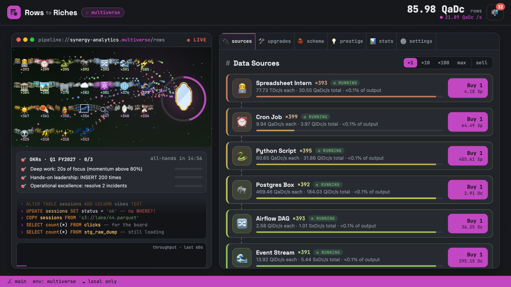

# Rows to Riches

An idle game about data engineering and the corporate world around it. Start with one CSV on `localhost`, hire spreadsheet interns, schedule cron jobs that email you every minute forever, and grow into warehouses, lakehouses, orbital data centers and a Dyson Warehouse. Then the aliens arrive, and they have seven kinds of NULL.

**Play:** [rowstoriches.drumandbytes.dev](https://rowstoriches.drumandbytes.dev) · part of [Drumandbytes Projects](https://drumandbytes.com/projects/)



## The game

You click **INSERT** to add rows, buy data sources that add rows for you, and upgrade them. The story starts reasonable and gets steadily sillier, through 17 environments from localhost to *everything is data*.

- **26 data sources**, from Spreadsheet Intern to Everything Is Data, each standing on the pipeline and shipping packets to storage.
- **About 330 upgrades**: ×2 per source, synergies between neighbouring sources, a stronger INSERT.
- **Schema**: columns multiply everything. Alien data types (`QUBIT`, `VIBE`, `NULLER_THAN_NULL`, …) make them stronger.
- **Corporate life**: quarterly OKRs graded at an all-hands, stakeholder requests and meetings as two-choice cards, phishing tests you pass by *not* clicking.
- **Incidents** to click: PagerDuty alerts, backfills, viral dashboards, wormholes, abductions.
- **An inbox** of about 50 emails, news items and vendor notices from parody vendors such as Sixtran, Snowfake and Databucks.
- **250+ achievements**, some secret, each worth +1% production.
- **Ten number notations**, from "Finance deck" (1.23 M) to "Legacy mainframe" (Roman numerals). Numbers have no practical ceiling.
- **Generative music** and sound effects, synthesized live with Web Audio: one mood per environment, no audio files.
- **Offline progress**, an installable app that plays offline, and a walkthrough for new players.

Keyboard: <kbd>Space</kbd> INSERT · <kbd>1</kbd>–<kbd>6</kbd> tabs · <kbd>B</kbd> buy amount · <kbd>M</kbd> mute · <kbd>F</kbd> full screen.

### Prestige

Each layer resets everything below it in exchange for a currency that makes the next run faster. Currencies come from a root of the rows earned, and their bonuses are soft-capped, so progress keeps a steady pace instead of snowballing.

| Layer | Currency | Spent on |
| --- | --- | --- |
| 💡 **Re-platform** | Insights | **Architecture** (one-time picks) and the **Tech Radar** (levelled tracks) |
| 📈 **Acquisition** | Equity | **The Board**: automation, the R&D Lab's extra sources, multipliers |
| 👽 **First Contact** | Xenobytes | **Xenotech**: alien sources, alien data types, automation |
| 🌀 **Big Bang** | Axioms | Never spent: every Axiom boosts production and every prestige gain |

**Challenges** are runs under a restriction (no columns, no INSERT, sources ×100 cost, …), in up to four tiers with fixed goals and a one-hour limit. Finishing faster earns a bigger speed bonus. They aren't optional: each prestige needs three completed challenges of the layer below.

**Big Bang milestones** (at 1, 10, 20, 50, … 500 Big Bangs) automate the game and make earlier layers permanent. At 50, **Catalog Everything** completes the game and starts New Game+, with production ×2 per completion.

A simulated optimal player reaches the first acquisition after about 9 hours, First Contact after about 85, the first Big Bang after about 112 and Catalog Everything after about 350. Real players take longer: the game is meant to be left running.

## Saves, privacy and fair play

The game is local-first: it saves in your browser every few seconds. Nothing identifies you, and the page loads nothing from third parties (fonts and scripts are self-hosted); the only outside script is Cloudflare's cookieless page-view counter.

- **Cloud save (optional)**: create an account code (`R2R-XXXX-…`) and enter it on another device. No email and no password; the server stores your save and a hash of the code. Delete both any time under Settings → Save.
- **Anonymous gameplay stats**: events like "a session lasted 25 minutes in prod", with no identifiers, to help balance the game. Turn them off under Settings → Save. Browsers sending Global Privacy Control or Do Not Track start with them off.
- **Notifications (optional)**: a push when your offline storage is full, or 10 minutes before a running challenge times out. The server stores only your browser's push address and the times, until they're sent.
- **Leaderboards (optional)**: fastest Catalog Everything, most rows, most Big Bangs and most Catalogs. You appear under a generated name like "Idempotent Grumpy Walrus" and can remove yourself any time.
- **On [galaxy.click](https://galaxy.click)**, signed-in players get galaxy's own cloud saves instead of account codes (`public/js/galaxy.js`).
- **Export / import** moves a save by hand, for example between galaxy.click and the main site.

Saves are encoded and sealed, so a save edited by hand still plays but is marked as modified and never ranked. The server re-checks every uploaded save against the game's own rules: currencies must match the rows earned, and rows can't grow faster than the save could produce them in real time. Leaderboard times come from the server's clock, from a ticket signed when the game starts.

## How it's built

Plain ES modules, no framework and no build step, on a single Cloudflare Worker.

| Path | What's there |
| --- | --- |
| `public/` | The whole client, served as static assets: `index.html`, `style.css`, ES modules in `public/js/`, a service worker for offline play |
| `public/js/economy.js` | All game rules as pure functions. The Worker imports the same file to validate saves |
| `public/js/main.js` | State, the game loop and rendering |
| `worker/` | The API: account codes, cloud saves, anonymous stats, feedback, push notifications, leaderboards |
| `migrations/` | The D1 (SQLite) schema |
| `tools/` | The balance simulator and other scripts, below |
| `test/` | `node:test` suites, plus a browser smoke test |

Big numbers use [break_infinity.js](https://github.com/Patashu/break_infinity.js), vendored in `public/js/lib/`.

## Running it locally

Needs Node 24 (see `mise.toml`).

```bash
npm install
npm run db:migrate:local
npm run dev            # http://localhost:8787
npm test               # unit tests and the music audit
```

The browser smoke test needs Chromium: `npx playwright-core install chromium`, then `CHROMIUM=1 npm run test:browser`.

Notifications and leaderboards stay hidden until their keys exist. To try them locally, put keys into `.dev.vars` (gitignored):

```bash
echo "VAPID_PRIVATE_JWK=$(node tools/vapid.js)" >> .dev.vars
echo "LEADERBOARD_KEY=$(openssl rand -base64 32 | tr '+/' '-_' | tr -d '=\n')" >> .dev.vars
```

### Tools

| Command | What it does |
| --- | --- |
| `node tools/sim.js 72` | Plays greedily for 72 simulated hours and prints prestige milestones. `SUMMARY=1` prints one pacing line, `TWEAK='…'` tries a balance change without editing the code |
| `node tools/pace.js` | Regenerates `worker/pace.json`, the simulator's milestone times that leaderboard runs are compared against |
| `node tools/screenshots.js` | Regenerates the screenshots in `docs/listing/` |
| `node tools/og-image.js` | Regenerates `public/og.png`, the 1200×630 share card (uses `docs/listing/4-multiverse.png`) |
| `node tools/music-audit.js` | Plays every music mood "on paper" and checks the composer's rules |
| `node tools/check-live.js` | Checks that every file in `public/` loads from the live site |

## Contributing

Commits and PR titles follow [Conventional Commits](https://www.conventionalcommits.org/) (`feat: …`, `fix: …`): [release-please](https://github.com/googleapis/release-please) builds the version and `CHANGELOG.md` from them, and each release deploys automatically. Balance changes should come with a `node tools/sim.js` run showing that no layer snowballs.

Maintainer notes (deploys, secrets, moderation) are in [`docs/maintaining.md`](docs/maintaining.md).

## License

[PolyForm Noncommercial 1.0.0](LICENSE.md): you may read, run, modify and share the game for any noncommercial purpose, including personal use, study and hobby projects. Commercial use, such as hosting a copy with ads or selling it, isn't permitted. The vendored [break_infinity.js](public/js/lib/break_infinity.js) keeps its own [MIT license](public/js/lib/break_infinity.LICENSE.txt).
